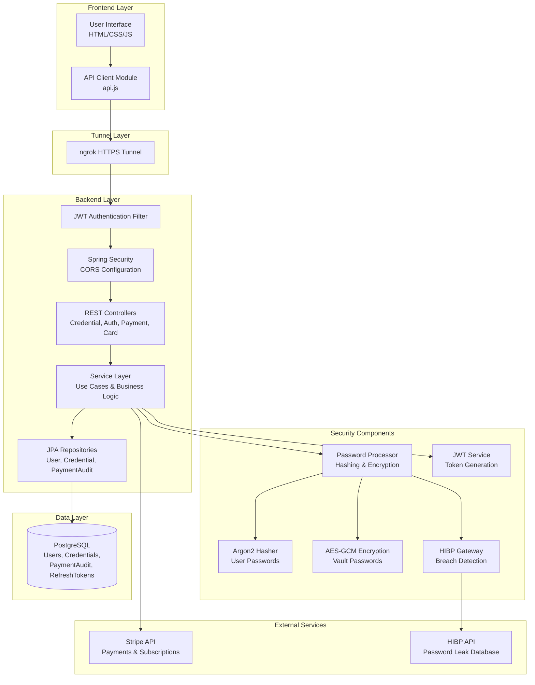

# FortressPass Password Manager

A secure password management application with a server-trusted architecture, built with Spring Boot and vanilla JavaScript. FortressPass provides encrypted credential storage, password strength analysis, breach detection via HIBP integration, and subscription management through Stripe.

## Overview

FortressPass is a full-stack password manager that centralizes password management logic on the backend. The application stores user credentials encrypted at rest, validates password strength, checks for compromised passwords using the Have I Been Pwned API, and integrates with Stripe for subscription management. The frontend serves as a presentation layer that communicates with the backend API.

## Key Features

- **Encrypted Credential Storage**: Vault passwords are encrypted server-side using AES-256-GCM before persistence
- **Password Strength Analysis**: Custom strength validation that evaluates length, character variety, and complexity
- **Breach Detection**: Integration with Have I Been Pwned (HIBP) API to detect compromised passwords
- **User Authentication**: JWT-based authentication with access tokens and secure refresh tokens stored in HTTP-only cookies
- **Password Hashing**: User account passwords are hashed using Argon2 (Argon2id variant)
- **Subscription Management**: Stripe integration for PRO and BUSINESS subscription plans
- **Payment Method Management**: Users can add and manage payment methods via Stripe
- **Credential CRUD Operations**: Create, read, update, and delete credentials with category filtering
- **Dashboard UI**: Visual interface with password metrics, strength indicators, and category organization

## Technology Stack

### Backend
- **Framework**: Spring Boot 4.1.0
- **Language**: Java 21
- **Build Tool**: Maven
- **Database**: PostgreSQL with JPA/Hibernate
- **Security**: Spring Security with JWT (jjwt 0.12.6)
- **Password Hashing**: Argon2 (argon2-jvm 2.12)
- **Password Encryption**: AES-256-GCM (Java Cryptography Architecture)
- **API Client**: Spring WebFlux WebClient
- **Payment Processing**: Stripe Java SDK 33.4.0
- **Environment Configuration**: dotenv-java 3.0.0
- **Validation**: Jakarta Bean Validation

### Frontend
- **Language**: Vanilla JavaScript (ES6+ modules)
- **Styling**: Custom CSS with Font Awesome icons
- **Fonts**: Google Fonts (Montserrat)
- **Payment UI**: Stripe Elements (commented out in current implementation)
- **Architecture**: Modular JavaScript with custom API client

### Infrastructure
- **Tunneling**: ngrok for local development HTTPS tunneling
- **Database**: PostgreSQL (local or cloud-hosted)

## System Architecture



## Backend Architecture

The backend follows a layered architecture with clear separation of concerns:

### Controller Layer
REST controllers handle HTTP requests and delegate to service use cases:
- `CredentialController`: CRUD operations for credentials
- `UserController`: Authentication (login, register, logout, token refresh)
- `PaymentController`: Subscription creation
- `CardController`: Payment method management
- `PaymentWebhookController`: Stripe webhook handling
- `UserSettingsController`: User profile and settings

### Service Layer
Service classes encapsulate business logic through use case patterns:
- `CredentialCreatorUseCase`, `CredentialProviderUseCase`, `CredentialUpdateUseCase`, `CredentialDeleteUseCase`: Credential lifecycle management
- `LoginUserUseCase`, `RegisterUserUseCase`: Authentication flows
- `PaymentService`, `UpdatePayment`: Subscription and payment logic
- `PasswordProcessor`: Central password processing (strength validation, encryption, hashing)
- `CheckPasswordLeakUseCase`: HIBP breach detection

### Repository Layer
JPA repositories provide data access:
- `UserRepository`: User account persistence
- `CredentialsRepository`: Credential storage
- `PaymentAuditLogRepository`: Payment transaction history
- `RefreshRepository`: Refresh token management

### Security Layer
- `SecurityConfig`: Spring Security configuration with global CORS and JWT filter
- `JwtAuthenticationFilter`: Intercepts requests, validates JWT tokens
- `JwtService`: Token generation and validation
- `PasswordHasher`: Argon2 hashing for user passwords
- `PasswordEncryption`: AES-GCM encryption for vault passwords
- `CredentialSecurity`: Custom authorization checks for credential ownership

### Request Lifecycle
1. Frontend sends HTTP request through ngrok tunnel
2. `JwtAuthenticationFilter` validates JWT from Authorization header
3. Security filter chain checks role-based permissions
4. Controller receives request, validates with Bean Validation
5. Service use case executes business logic
6. Repository persists or retrieves data from PostgreSQL
7. Response returns through ngrok to frontend

## Password Management and Security Model

### Where Password-Management Logic Resides

The backend handles all password-management operations:
- **Vault passwords**: Encrypted server-side using AES-256-GCM before storage
- **User passwords**: Hashed with Argon2 for authentication
- **Password strength validation**: Custom logic evaluating length and character complexity
- **Breach detection**: HIBP API integration checks if passwords appear in known breaches
- **Password generation**: Frontend generates random passwords, backend validates and encrypts

The frontend focuses on:
- Displaying credentials in the dashboard
- Collecting user input via forms
- Making API calls to backend endpoints
- Presenting password strength indicators
- Handling user interactions (copy, view, edit, delete)

### Conventional Server-Trusted Model

FortressPass uses a conventional server-trusted architecture:

| Aspect | Implementation |
|--------|----------------|
| **Vault Password Encryption** | AES-256-GCM with server-managed key from `ENCRYPTION_KEY` environment variable |
| **User Password Hashing** | Argon2id (3 iterations, 64MB memory, 1 parallelism) |
| **Key Storage** | Encryption key stored in backend environment configuration |
| **Server Access** | Backend can decrypt vault passwords using the stored encryption key |
| **Client-Side Crypto** | None; encryption occurs on the server before persistence |

### Distinction from Zero-Knowledge Architecture

In a Zero-Knowledge password manager:
- Encryption and decryption happen entirely on the client
- The server never has access to the encryption key
- The server stores only encrypted data it cannot read
- Users derive keys from their master password locally

In FortressPass's current architecture:
- Vault passwords are encrypted on the server
- The server holds the encryption key in environment configuration
- The backend can decrypt passwords for the authenticated user
- This is a deliberate architectural choice for simplicity and learning purposes

### Verified Encryption and Key-Management Behavior

**Vault Password Encryption**:
- Algorithm: AES-256-GCM (Galois/Counter Mode)
- Key derivation: Base64-decoded value from `ENCRYPTION_KEY` environment variable
- IV handling: 12-byte IV prepended to ciphertext
- Storage: Ciphertext stored as `byte[]` in `password_ciphertext` column

**User Password Hashing**:
- Algorithm: Argon2id
- Parameters: 3 iterations, 64MB memory, 1 parallelism
- Storage: PHC-formatted hash string in `hashed_password` column

**JWT Token Security**:
- Algorithm: HS256 (HMAC-SHA-256)
- Secret: From `JWT_SEKRET` environment variable
- Access token lifetime: Configured via `JWT_TOKEN_MINUTES`
- Refresh token lifetime: Configured via `JWT_TOKEN_DAYS`
- Refresh token storage: HTTP-only cookie

### Known Limitations

1. **Server Can Decrypt Vault Passwords**: The backend environment contains the encryption key, allowing the server to decrypt stored credentials. This is not a Zero-Knowledge architecture.

2. **Global CORS Configuration**: CORS is configured to allow all origins with credentials. This is permissive for development and should be restricted to specific origins in production. See the [CORS Configuration](#cors-configuration) section for details.

3. **Password Strength Algorithm**: The current strength validation is a custom implementation that evaluates character variety and length. It does not use entropy estimation or common password dictionaries.

4. **HIBP API Dependency**: Password breach detection requires the HIBP API to be available. Network failures or API rate limits may temporarily disable this feature.

5. **No Client-Side Encryption**: All cryptographic operations for vault passwords occur on the server. A compromised server could potentially access plaintext passwords.

6. **No Refresh Token Rotation**: The refresh token is not rotated on refresh. The same token is re-sent in the cookie. A compromised refresh token remains valid until expiration or logout.

### Potential Future Improvements

- Implement client-side encryption using a user-derived master password
- Transition to a Zero-Knowledge architecture where the server cannot decrypt vault contents
- Integrate a more sophisticated password strength estimator (e.g., zxcvbn)
- Restrict CORS origins to specific domains in production
- Add rate limiting and request throttling
- Implement audit logging for credential access
- Add multi-factor authentication (MFA) support

## CORS Configuration

### Current Implementation

CORS is configured globally in `SecurityConfig.java`:

```java
@Bean
public CorsConfigurationSource corsConfigurationSource() {
    CorsConfiguration configuration = new CorsConfiguration();
    configuration.setAllowedOriginPatterns(List.of("*"));
    configuration.setAllowedMethods(List.of("GET", "POST", "PUT", "PATCH", "DELETE", "OPTIONS"));
    configuration.setAllowedHeaders(List.of("*"));
    configuration.setAllowCredentials(true);
    configuration.setMaxAge(3600L);
    UrlBasedCorsConfigurationSource source = new UrlBasedCorsConfigurationSource();
    source.registerCorsConfiguration("/**", configuration);
    return source;
}
```

### What This Means

- **Allowed Origins**: All origins (`*`) via `setAllowedOriginPatterns`
- **Allowed Methods**: GET, POST, PUT, PATCH, DELETE, OPTIONS
- **Allowed Headers**: All headers
- **Credentials**: Enabled (allows cookies and authorization headers)
- **Scope**: Applied globally to all endpoints (`/**`)

### Rationale for Global Configuration

The project uses a centralized CORS configuration to:
- Simplify development by allowing the frontend (served via different origin through ngrok) to communicate with the backend
- Avoid configuring CORS on each controller or endpoint individually
- Enable credential-based authentication (refresh tokens in HTTP-only cookies)

### Security Implications

**Current Behavior**:
- Any origin can make requests to the backend
- Credentials (cookies, authorization headers) are permitted
- This is suitable for local development with ngrok

**Production Considerations**:
- In production, `setAllowedOriginPatterns` should be restricted to specific frontend domains
- Example: `configuration.setAllowedOrigins(List.of("https://fortresspass.example.com"))`
- The `AllowCredentials(true)` setting requires specific origins (not `*`) in strict CORS implementations
- Environment-specific configuration (e.g., separate CORS settings for dev/staging/prod) is recommended

**Important Security Distinction**:
CORS is a browser-enforced mechanism for cross-origin requests. It does not replace backend authentication, authorization, or access controls. The application enforces security through Spring Security, JWT validation, and role-based permissions regardless of CORS configuration.

## Project Structure

```
Password_Manager/
├── Password Manager Backend/
│   ├── src/
│   │   ├── main/
│   │   │   ├── java/org/example/password_manager_service/
│   │   │   │   ├── config/
│   │   │   │   │   └── SecurityConfig.java
│   │   │   │   ├── entities/
│   │   │   │   │   ├── credential/
│   │   │   │   │   │   ├── Credential.java
│   │   │   │   │   │   └── CredentialCategories.java
│   │   │   │   │   ├── payment_audit/
│   │   │   │   │   │   ├── PaymentAuditLog.java
│   │   │   │   │   │   ├── PaymentStatus.java
│   │   │   │   │   │   └── Plan.java
│   │   │   │   │   └── user/
│   │   │   │   │       ├── User.java
│   │   │   │   │       ├── Role.java
│   │   │   │   │       ├── UserStatus.java
│   │   │   │   │       ├── UserSubscription.java
│   │   │   │   │       └── UserRefreshToken.java
│   │   │   │   ├── repository/
│   │   │   │   │   ├── CredentialsRepository.java
│   │   │   │   │   ├── PaymentAuditLogRepository.java
│   │   │   │   │   ├── RefreshRepository.java
│   │   │   │   │   └── UserRepository.java
│   │   │   │   ├── service/
│   │   │   │   │   ├── auth_user/
│   │   │   │   │   │   ├── login_user/
│   │   │   │   │   │   └── register_user/
│   │   │   │   │   ├── cards_service/
│   │   │   │   │   ├── credential/
│   │   │   │   │   │   ├── create/
│   │   │   │   │   │   ├── delete/
│   │   │   │   │   │   ├── provider/
│   │   │   │   │   │   └── update/
│   │   │   │   │   ├── payment/
│   │   │   │   │   └── user_settings/
│   │   │   │   ├── shared/
│   │   │   │   │   ├── security/
│   │   │   │   │   │   ├── encrypted/
│   │   │   │   │   │   ├── JWT/
│   │   │   │   │   │   ├── passwordAnalyze/
│   │   │   │   │   │   ├── PasswordHasher.java
│   │   │   │   │   │   └── PasswordProcessor.java
│   │   │   │   │   ├── geteway/
│   │   │   │   │   │   ├── HibpConfig.java
│   │   │   │   │   │   └── HibpGateway.java
│   │   │   │   │   ├── validator/
│   │   │   │   │   │   ├── EmailValidator.java
│   │   │   │   │   │   └── PasswordLevel.java
│   │   │   │   │   └── exceptions/
│   │   │   │   └── web/
│   │   │   │       ├── auth/
│   │   │   │       ├── card/
│   │   │   │       ├── credential/
│   │   │   │       ├── payment/
│   │   │   │       └── webhook/
│   │   │   └── resources/
│   │   │       └── application.properties
│   │   └── test/
│   │       └── java/org/example/password_manager_service/
│   ├── .env.example
│   ├── .gitignore
│   ├── pom.xml
│   └── mvnw
└── Password Manager FrontEnd/
    ├── img/
    ├── src/
    │   ├── addPassword.js
    │   ├── api.js
    │   ├── asideAnimation.js
    │   ├── closeAside.js
    │   ├── copyModal.js
    │   ├── emailCheck.js
    │   ├── eyeLogin.js
    │   ├── eyeModal.js
    │   ├── eyePassword.js
    │   ├── fetchRequieresReg.js
    │   ├── getPasswordScore.js
    │   ├── js.js
    │   ├── loginSend.js
    │   ├── main.js
    │   ├── modalWindow.js
    │   ├── passGenerate.js
    │   ├── passwordCheck.js
    │   ├── passwordCheckModal.js
    │   ├── profile.js
    │   ├── registerSend.js
    │   └── settingsModal.js
    ├── dashboard.css
    ├── dashboard.html
    ├── index.html
    ├── login.css
    ├── login.html
    ├── register.css
    ├── register.html
    └── style.css
```

## Getting Started

### Prerequisites

- **Java**: JDK 21
- **Maven**: Included via Maven Wrapper (`mvnw`)
- **PostgreSQL**: Database server (local installation or cloud-hosted)
- **Node.js**: Not required (frontend uses vanilla JavaScript)
- **ngrok**: For creating HTTPS tunnels to the local backend
- **Stripe Account**: For payment and subscription functionality (optional for free tier)

### Installation

#### 1. Clone the Repository

```bash
git clone <repository-url>
cd Password_Manager
```

#### 2. Backend Setup

Navigate to the backend directory:

```bash
cd "Password Manager Backend"
```

Install dependencies using the Maven Wrapper:

```bash
./mvnw clean install
```

On Windows (Git Bash or PowerShell):

```bash
./mvnw.cmd clean install
```

#### 3. Database Setup

Ensure PostgreSQL is running and create a database:

```sql
CREATE DATABASE password_manager;
```

#### 4. Environment Configuration

Create a `.env` file in the `Password Manager Backend` directory based on `.env.example`:

```bash
cp .env.example .env
```

Edit `.env` with your actual values:

```env
HIBP_API=https://api.pwnedpasswords.com
DB_URL=jdbc:postgresql://localhost:5432/password_manager
DB_NAME=your_postgresql_username
DB_PASSWORD=your_postgresql_password
JWT_SEKRET=your_jwt_secret_key_minimum_32_characters
JWT_TOKEN_MINUTES=30
JWT_TOKEN_DAYS=7
STRIPE_API_KEY=sk_test_your_stripe_secret_key
WEBHOOK_SECRET=whsec_your_stripe_webhook_secret
STIPE_SUB_PRO=price_your_stripe_pro_subscription_price_id
STRIPE_SUB_BIS=price_your_stripe_business_subscription_price_id
ENCRYPTION_KEY=your_base64_encoded_32_byte_encryption_key
```

**Important Notes**:
- `JWT_SEKRET` should be a random string at least 32 characters long
- `ENCRYPTION_KEY` must be a Base64-encoded 32-byte (256-bit) key
- Generate a secure encryption key using: `openssl rand -base64 32`
- Stripe keys are optional if you only need free-tier functionality
- Do not commit `.env` to version control

#### 5. Frontend Setup

The frontend is static HTML/CSS/JavaScript and requires no build process. However, you need to configure the API base URL.

Navigate to the frontend directory:

```bash
cd "../Password Manager FrontEnd"
```

Edit `src/api.js` and update the `API_BASE` constant:

```javascript
export const API_BASE = "https://your-ngrok-url.ngrok-free.dev";
```

#### 6. ngrok Configuration

ngrok is required to tunnel your local backend to a public HTTPS URL that the frontend can access.

**Install ngrok**:
- Download from [ngrok.com](https://ngrok.com/download)
- Follow installation instructions for your operating system
- Sign up for a free ngrok account

**Authenticate ngrok**:
```bash
ngrok config add-authtoken YOUR_AUTH_TOKEN
```

Replace `YOUR_AUTH_TOKEN` with your actual ngrok authtoken from your dashboard.

**Start the Backend** (see "Running the Backend" section below).

**Start the ngrok Tunnel**:
```bash
ngrok http 8080
```

This assumes your backend runs on port 8080 (default Spring Boot port). If your backend uses a different port, adjust the command accordingly.

**Copy the HTTPS URL**:
ngrok will display a forwarding URL like:
```
Forwarding  https://caviar-cupped-resilient.ngrok-free.dev -> http://localhost:8080
```

Copy the HTTPS URL (not the HTTP URL).

**Update Frontend Configuration**:
In `Password Manager FrontEnd/src/api.js`, replace the `API_BASE` value with your ngrok HTTPS URL:

```javascript
export const API_BASE = "https://your-actual-ngrok-url.ngrok-free.dev";
```

**Restart the Frontend**:
After changing `api.js`, refresh your browser to load the updated configuration.

### Running the Backend

Navigate to the backend directory:

```bash
cd "Password Manager Backend"
```

Ensure your `.env` file is configured and PostgreSQL is running.

Start the application using Maven:

```bash
./mvnw spring-boot:run
```

On Windows:

```bash
./mvnw.cmd spring-boot:run
```

**Expected Output**:
The application will start on `http://localhost:8080` by default. You should see logs indicating:
- Spring Boot startup
- Database connection established
- JPA entities mapped
- Security filter chain initialized

**Troubleshooting Backend Startup**:
- If port 8080 is in use, change it in `application.properties`: `server.port=8081`
- Check that PostgreSQL is running and credentials in `.env` are correct
- Verify that all required environment variables are set in `.env`
- Ensure Java 21 is installed: `java -version`

### Running the Frontend

The frontend is static and can be served by any web server or opened directly in a browser.

**Option 1: Using a Local Web Server (Recommended)**

Using Python 3:
```bash
cd "Password Manager FrontEnd"
python -m http.server 3000
```

Using Node.js (with http-server):
```bash
cd "Password Manager FrontEnd"
npx http-server -p 3000
```

Using VS Code Live Server extension:
- Install the "Live Server" extension
- Right-click `index.html` and select "Open with Live Server"

**Option 2: Direct File Access**

Open `Password Manager FrontEnd/index.html` directly in your browser. Note that some browsers may restrict file:// protocol AJAX requests, so a local web server is recommended.

**Expected Behavior**:
- Navigate to `http://localhost:3000` (or your chosen port)
- You should see the FortressPass landing page
- Click "Get Started" to register or "Sign In to Vault" to log in

**When to Use ngrok URL vs Local URL**:
- **Local Development**: If frontend and backend are both local, you can use `http://localhost:8080` in `api.js` and skip ngrok
- **Cross-Origin Requirements**: If you need HTTPS or are running frontend on a different origin, use the ngrok HTTPS URL
- **Payment Testing**: Stripe requires HTTPS for live payments, so ngrok is necessary for payment flow testing

### Recommended Startup Order

1. Start PostgreSQL database
2. Configure `.env` file in backend directory
3. Start backend: `./mvnw spring-boot:run` (from backend directory)
4. Verify backend is responding: `curl http://localhost:8080/auth/register` (should return 405 Method Not Allowed, indicating server is up)
5. Start ngrok: `ngrok http 8080` (in a separate terminal)
6. Copy the ngrok HTTPS URL
7. Update `API_BASE` in `Password Manager FrontEnd/src/api.js` with the ngrok URL
8. Start frontend web server: `python -m http.server 3000` (from frontend directory)
9. Open browser to `http://localhost:3000`
10. Test registration and login to verify connectivity

### Troubleshooting

| Problem | Possible Cause | What to Check |
|---------|----------------|--------------|
| Backend fails to start | Missing environment variables or unavailable dependencies | Verify `.env` file exists and contains all required variables; check PostgreSQL is running; ensure Java 21 is installed |
| Frontend cannot reach the API | Incorrect API base URL | Check `API_BASE` in `src/api.js` matches your ngrok or local backend URL |
| Requests fail with CORS errors | Frontend origin not permitted by CORS configuration | Current configuration allows all origins; if you modified `SecurityConfig.java`, verify `setAllowedOriginPatterns` includes your frontend origin |
| ngrok URL no longer works | Tunnel stopped or temporary URL changed | Restart ngrok tunnel and update `API_BASE` in `src/api.js` with the new URL |
| Database connection fails | Incorrect credentials, host, port, or database state | Verify PostgreSQL is running; check `DB_URL`, `DB_NAME`, `DB_PASSWORD` in `.env`; ensure database exists |
| Registration fails with password error | Password does not meet strength requirements | Backend requires passwords with minimum length and character variety; check `PasswordLevel.java` validation logic |
| Environment changes have no effect | Application needs restart or rebuild | Spring Boot loads environment variables at startup; restart backend after changing `.env` |
| Stripe payment fails | Invalid API key or webhook secret | Verify `STRIPE_API_KEY` and `WEBHOOK_SECRET` in `.env`; check Stripe dashboard for correct keys |
| HIBP breach detection fails | HIBP API unavailable or network issue | Check internet connectivity; verify `HIBP_API` URL in `.env` is correct |

### Final Verification Checklist

- [ ] All required dependencies installed (Java 21, Maven, PostgreSQL, ngrok)
- [ ] Environment variables configured in `Password Manager Backend/.env`
- [ ] PostgreSQL database available and initialized
- [ ] Backend starts successfully on port 8080
- [ ] ngrok tunnel running and HTTPS URL copied
- [ ] Frontend `API_BASE` in `src/api.js` updated with correct URL
- [ ] Frontend web server running on port 3000
- [ ] Browser can access `http://localhost:3000`
- [ ] Registration flow creates a new user
- [ ] Login flow authenticates and redirects to dashboard
- [ ] Dashboard loads and displays credential list
- [ ] Create credential operation succeeds
- [ ] CORS allows requests from frontend origin

## Environment Variables

The backend requires the following environment variables in the `.env` file:

| Variable | Required | Description | Example |
|----------|----------|-------------|---------|
| `HIBP_API` | Yes | Base URL for Have I Been Pwned API | `https://api.pwnedpasswords.com` |
| `DB_URL` | Yes | JDBC connection string for PostgreSQL | `jdbc:postgresql://localhost:5432/password_manager` |
| `DB_NAME` | Yes | PostgreSQL username | `postgres` |
| `DB_PASSWORD` | Yes | PostgreSQL password | `your_secure_password` |
| `JWT_SEKRET` | Yes | Secret key for JWT token signing (min 32 chars) | `your_very_secure_random_secret_key_minimum_32_characters` |
| `JWT_TOKEN_MINUTES` | Yes | Access token lifetime in minutes | `30` |
| `JWT_TOKEN_DAYS` | Yes | Refresh token lifetime in days | `7` |
| `STRIPE_API_KEY` | Optional | Stripe secret key for payments | `sk_test_51UCP92...` |
| `WEBHOOK_SECRET` | Optional | Stripe webhook signing secret | `whsec_...` |
| `STIPE_SUB_PRO` | Optional | Stripe price ID for PRO subscription | `price_...` |
| `STRIPE_SUB_BIS` | Optional | Stripe price ID for BUSINESS subscription | `price_...` |
| `ENCRYPTION_KEY` | Yes | Base64-encoded 32-byte key for AES encryption | Generate with `openssl rand -base64 32` |

**Note**: The `.env.example` file includes both `STRIPE_API` and `STRIPE_API_KEY`, but `application.properties` only references `STRIPE_API_KEY`. Use `STRIPE_API_KEY` in your `.env` file. Also note that Stripe Elements is commented out in `dashboard.html`, so payment UI integration is not currently active.

**Generating a Secure Encryption Key**:
```bash
openssl rand -base64 32
```

Copy the output to the `ENCRYPTION_KEY` variable.

**Frontend Configuration**:
The frontend does not use environment variables. Configure the API base URL by editing `Password Manager FrontEnd/src/api.js`:

```javascript
export const API_BASE = "https://your-ngrok-url.ngrok-free.dev";
```

## API Overview

### Authentication Endpoints

#### Register User
- **POST** `/auth/register`
- **Body**: `{ "firstName": "string", "lastName": "string", "email": "string", "password": "string", "confirmPassword": "string", "isTermsAccepted": boolean }`
- **Response**: 201 Created
- **Description**: Creates a new user account with Argon2-hashed password

#### Login
- **POST** `/auth/login`
- **Body**: `{ "email": "string", "password": "string" }`
- **Response**: 200 OK with `{ "accessToken": "string" }`
- **Description**: Authenticates user and returns access token; refresh token set in HTTP-only cookie

#### Refresh Access Token
- **POST** `/auth/refresh`
- **Cookie**: `refresh` (HTTP-only)
- **Response**: 200 OK with `{ "accessToken": "string" }`
- **Description**: Uses refresh token to generate new access token. Note: The refresh token is not rotated on refresh; the same token is re-sent in the cookie.

#### Logout
- **POST** `/auth/logout`
- **Cookie**: `refresh` (HTTP-only)
- **Response**: 200 OK
- **Description**: Invalidates refresh token and clears session

### Credential Endpoints

#### Create Credential
- **POST** `/credentials`
- **Headers**: `Authorization: Bearer <access_token>`
- **Body**: `{ "name": "string", "website": "string", "email": "string", "rawPassword": "string", "credentialCategories": "string" }`
- **Response**: 201 Created with credential details
- **Authentication**: Required (USER or ADMIN role)

#### Get All Credentials
- **GET** `/credentials`
- **Headers**: `Authorization: Bearer <access_token>`
- **Response**: 200 OK with array of credentials
- **Authentication**: Required (USER or ADMIN role)

#### Get Single Credential
- **GET** `/credentials/{id}`
- **Headers**: `Authorization: Bearer <access_token>`
- **Response**: 200 OK with credential details
- **Authentication**: Required (USER or ADMIN role)
- **Authorization**: User must own the credential

#### Get Credential Password
- **GET** `/credentials/password/{id}`
- **Headers**: `Authorization: Bearer <access_token>`
- **Response**: 200 OK with plaintext password
- **Authentication**: Required (USER or ADMIN role)
- **Authorization**: User must own the credential

#### Update Credential
- **PATCH** `/credentials`
- **Headers**: `Authorization: Bearer <access_token>`
- **Body**: `{ "id": "uuid", "name": "string", "website": "string", "email": "string", "password": "string", "categories": "CREDENTIAL_CATEGORIES_ENUM" }`
- **Response**: 200 OK with updated credential
- **Authentication**: Required (USER or ADMIN role)
- **Authorization**: User must own the credential (checks credential ownership via `@PreAuthorize("@credentialSecurity.isOwner(#id, authentication))")` where `#id` references the `id` field in the request body

#### Delete Credential
- **DELETE** `/credentials/{id}`
- **Headers**: `Authorization: Bearer <access_token>`
- **Response**: 204 No Content
- **Authentication**: Required (USER or ADMIN role)
- **Authorization**: User must own the credential

### Payment Endpoints

#### Create Payment/Subscription
- **POST** `/payment`
- **Headers**: `Authorization: Bearer <access_token>`
- **Body**: `{ "paymentMethodId": "string", "plan": "PRO|BUSINESS" }`
- **Response**: 200 OK with payment status and client secret
- **Authentication**: Required (USER or ADMIN role)

### Card Endpoints

#### Add Payment Method
- **POST** `/card`
- **Headers**: `Authorization: Bearer <access_token>`
- **Body**: `{ "paymentMethodId": "string" }`
- **Response**: 200 OK with card details
- **Authentication**: Required (USER or ADMIN role)

#### Get User Cards
- **GET** `/card`
- **Headers**: `Authorization: Bearer <access_token>`
- **Response**: 200 OK with array of user's payment methods
- **Authentication**: Required (USER or ADMIN role)

### Webhook Endpoints

#### Stripe Webhook
- **POST** `/webhook/stripe`
- **Headers**: `Stripe-Signature: <signature>`
- **Body**: Stripe event payload
- **Response**: 200 OK
- **Authentication**: Public (verified via webhook signature)
- **Description**: Handles Stripe payment events and updates user subscription status

## Testing and Code Quality

### Test Coverage

The project includes unit tests for several use cases:

- `LoginUserUseCaseTest`: Tests user login flow
- `RegisterUserUseCaseTest`: Tests user registration flow
- `CredentialCreatorUseCaseTest`: Tests credential creation
- `CredentialDeleteUseCaseTest`: Tests credential deletion
- `CredentialProviderUseCaseTest`: Tests credential retrieval
- `CredentialUpdateUseCaseTest`: Tests credential updates
- `PasswordEncryptionTest`: Tests AES-GCM encryption/decryption
- `CheckPasswordLeakUseCaseTest`: Tests HIBP integration
- `EmailValidatorTest`: Tests email validation
- `PasswordLevelTest`: Tests password strength validation
- Controller tests for credential endpoints

### Running Tests

From the backend directory:

```bash
./mvnw test
```

On Windows:

```bash
./mvnw.cmd test
```

### Code Quality Notes

- **Linting**: No formal linting configured for JavaScript; consider adding ESLint
- **Type Safety**: JavaScript is untyped; TypeScript could be considered for future iterations
- **Java Best Practices**: Code uses Lombok for boilerplate reduction, follows Spring conventions
- **Validation**: Jakarta Bean Validation used on request DTOs
- **Error Handling**: Custom exception classes for domain-specific errors
- **Test Status**: Test coverage is present but not comprehensive; integration tests and end-to-end tests could improve confidence

## Security Considerations

### Existing Protections

1. **Password Hashing**: User account passwords hashed with Argon2id (memory-hard, resistant to GPU/ASIC attacks)
2. **Password Encryption**: Vault passwords encrypted with AES-256-GCM at rest
3. **JWT Authentication**: Stateless token-based authentication with role-based access control
4. **Secure Token Storage**: Refresh tokens stored in HTTP-only, Secure, SameSite=None cookies
5. **CSRF Protection**: Disabled for stateless JWT architecture. Note: SameSite=None cookies with CSRF disabled may introduce risk if the frontend is served from an untrusted origin. Restrict CORS origins in production to mitigate this risk.
6. **SQL Injection Protection**: JPA/Hibernate parameterized queries prevent SQL injection
7. **Breach Detection**: HIBP integration warns users of compromised passwords
8. **Input Validation**: Bean Validation on request DTOs
9. **Ownership Authorization**: Custom security checks ensure users can only access their own credentials

### Known Limitations and Production Hardening

1. **Global CORS**: Currently allows all origins. In production, restrict to specific frontend domains:
   ```java
   configuration.setAllowedOrigins(List.of("https://yourdomain.com"));
   ```

2. **Server-Side Encryption Key**: The `ENCRYPTION_KEY` in environment variables allows the server to decrypt vault passwords. Consider:
   - Moving to client-side encryption with user-derived keys
   - Using a key management service (KMS) for key storage
   - Implementing key rotation policies

3. **JWT Secret Storage**: JWT secret in environment variables. In production:
   - Use a secrets manager (AWS Secrets Manager, HashiCorp Vault)
   - Rotate secrets regularly
   - Use asymmetric keys (RS256) instead of symmetric (HS256) for JWT

4. **No Rate Limiting**: API endpoints lack rate limiting. Implement:
   - Spring Security rate limiting filters
   - Bucket4j or similar rate-limiting libraries
   - Per-endpoint rate limits (especially for auth endpoints)

5. **No Request Logging**: Security-relevant events not logged. Add:
   - Audit logging for credential access
   - Failed login attempt tracking
   - Suspicious activity alerts

6. **Password Strength Algorithm**: Custom implementation is simplistic. Consider:
   - Using zxcvbn4j for entropy-based strength estimation
   - Checking against common password dictionaries
   - Enforcing longer minimum lengths (16+ characters)

7. **No Multi-Factor Authentication**: Password-only authentication. Add:
   - TOTP-based 2FA
   - SMS or email verification codes
   - Hardware security key support (WebAuthn)

8. **ngrok in Development**: ngrok tunnels expose local backend publicly. Always:
   - Use your own ngrok account and authtoken
   - Stop tunnels when not in use
   - Do not use ngrok URLs in production configurations
9. **SameSite=None with CSRF Disabled**: The current configuration uses SameSite=None cookies with CSRF protection disabled. This combination is acceptable for a stateless JWT API with properly restricted CORS origins, but introduces risk if CORS is permissive. Restrict CORS to specific frontend domains in production.

## Potential Future Improvements

### Architecture
- Transition to Zero-Knowledge architecture with client-side encryption
- Implement microservices separation (auth service, vault service, payment service)
- Add event-driven architecture for audit logging and notifications
- Implement API versioning for backward compatibility

### Security
- Add multi-factor authentication (TOTP, WebAuthn)
- Implement client-side password encryption using Web Crypto API
- Add end-to-end encryption for credential sharing
- Implement security headers (CSP, HSTS, X-Frame-Options)
- Add API rate limiting and request throttling
- Implement session management with device tracking

### Features
- Add secure notes and file attachments
- Implement credential sharing between users
- Add emergency access and inheritance features
- Implement password change history and rollbacks
- Add browser extension for autofill
- Implement import/export (encrypted CSV, JSON)
- Add two-person approval for sensitive operations

### Infrastructure
- Containerize with Docker and Docker Compose
- Add CI/CD pipeline (GitHub Actions, GitLab CI)
- Implement automated security scanning (Snyk, OWASP Dependency-Check)
- Add monitoring and alerting (Prometheus, Grafana)
- Implement database migration tools (Flyway, Liquibase)
- Add integration tests with Testcontainers

### Developer Experience
- Add TypeScript to frontend for type safety
- Implement frontend framework (React, Vue, or Svelte) for better state management
- Add ESLint and Prettier for code quality
- Implement automated UI testing (Playwright, Cypress)
- Add API documentation (OpenAPI/Swagger)
- Improve error messages and user feedback

## License

This project does not currently have a specified license. Contact the project maintainers for information on usage and distribution rights.
